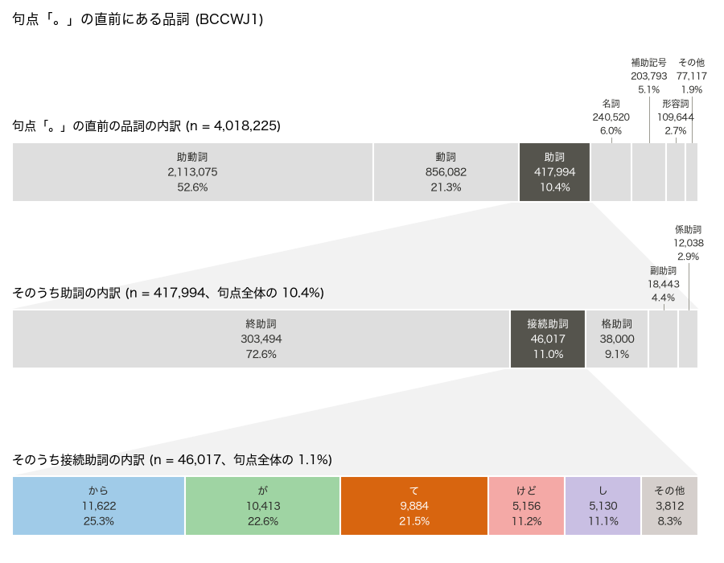
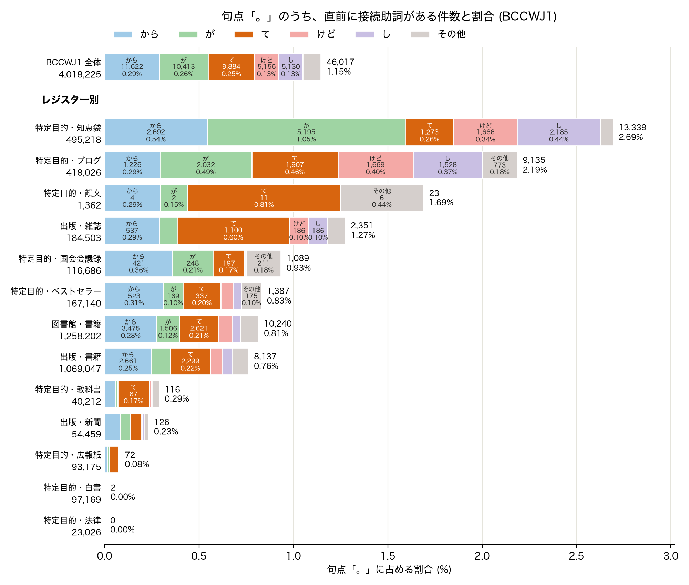
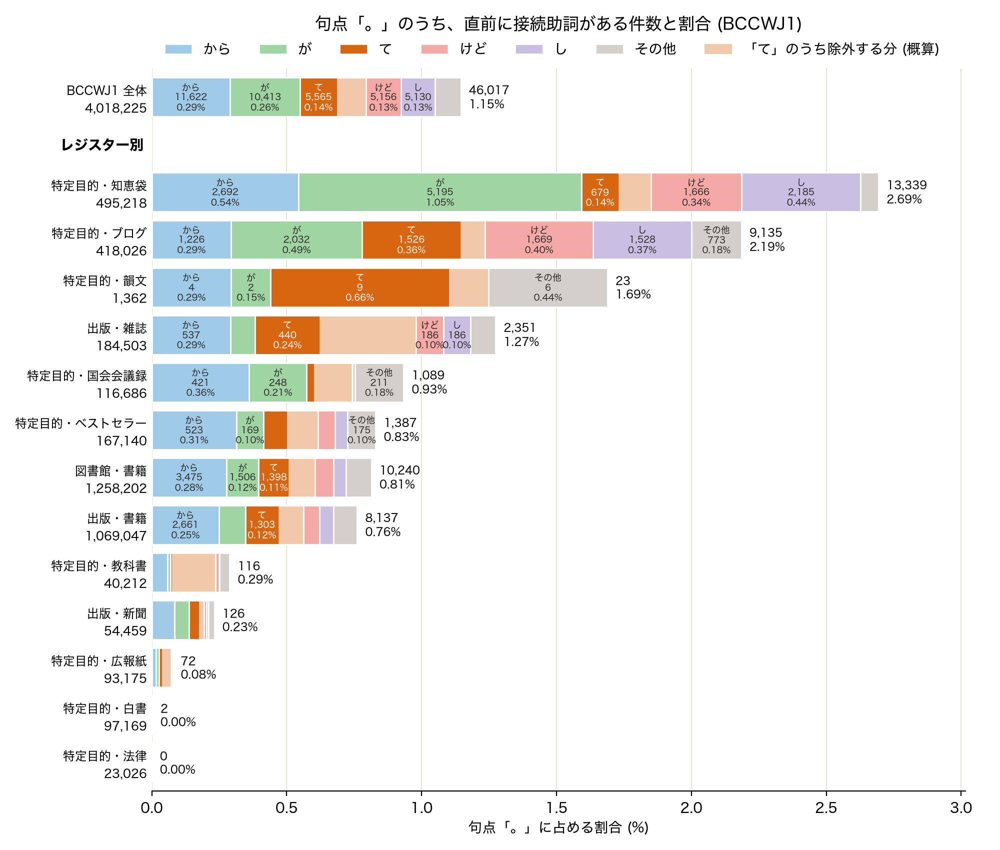

# 最近、助詞で文を区切るやつが多すぎるらしくて、コーパスで数えてみようと思って

「[最近、助詞で文を区切るやつが多すぎる気がしていて。](https://anond.hatelabo.jp/20261005100640)」というはてな匿名ダイアリーの記事（以降、「元記事」）を読んだ。

元記事は、「助詞で文を区切る書き方を最近よく見かけるが、何を表現しているのか疑問だ。どこ発祥なのか？」という内容で、記事の文章自体もその書き方で書かれている。全部で 10 文からなるが、文末は「〜て。」が 5 文、「〜と思い。」が 3 文、「〜疑問で。」が 2 文となっている。

そこで、接続助詞「て」[^1]+句点「。」[^2]（以下「て。」）について、『現代日本語書き言葉均衡コーパス 第1部』（BCCWJ1）での用例数を調べてみた。

[^1]: 文法によっては、動詞や形容詞のテ形の活用語尾として扱う場合もある。
[^2]: 「文」は句点「。」で終わるとは限らない。ほかの記号などで終わる場合もあるが、ここでは調査の対象外とする。

### 句点「。」の前に接続助詞がある用例を数える

BCCWJ1 を、中納言[^3]で検索した。

[^3]: https://chunagon.ninjal.ac.jp 中納言 2.7.3、データバージョン 形態論情報 2021.03

まず、句点「。」の直前にどんな品詞があるのかを見てみる。

半分以上は助動詞（「です。」「ます。」「た。」など）で、次に多いのは動詞、助詞は 10% ほどだった。

助詞のうちで最も多いのは終助詞（「ね。」「よ。」など）だった。接続助詞は 11% で、句点「。」全体からみると 1.1% になる。

接続助詞[^4]のなかでは「から」が最も多く、「が」と「て」が続く。

<!--[f:id:piijey:20261014231335p:plain]-->

接続助詞「て」+句点「。」は 9,884 件あり、句点「。」全体の 0.25%になる。

[^4]: ここでは、接続助詞を表層形で数えている。そのため、（記事執筆中に気づいたことだが、）語彙素が「て」である「で」（〜ないで、読んで、等）や「ちゃ」は「その他」に入り、次節以降で調査対象に含まれていない。「で。」は 729 件（そのうち、「〜ないで。」が 457 件）あった。 語彙素で数えると、「から」(11,628 件)、「て」(10,921 件)、「が」（10,419 件）、「けれど」 (5,787 件) の順になる。

### レジスター別に接続助詞の内訳を見る

BCCWJ1 には、書籍、雑誌、新聞、ブログ、知恵袋、国会会議録などのレジスターがある。レジスターごとに、句点「。」のうち「て。」が占める割合を数えた。

「て。」が多いのは雑誌 (0.60%) とブログ (0.46%) だった。韻文は 0.81% だが、BCCWJ1 での収録数が少ないため、「て。」の用例数は 11 件しかない。

話し言葉に近いレジスターで多いのかと思ったが、知恵袋は BCCWJ1 全体と比べると中程度（0.26%）で、国会会議録（0.17%）は少なかった。

<!--[f:id:piijey:20261014231437p:plain]-->

### 「て。」の用例を読む

実際にどのように「て。」が使われているのかを見るために、各レジスターから 30 件ずつ、合計 312 件をサンプリングして読む（30 件に満たないレジスターは全件とする）。

読んでみると、元記事で例示されているのとは明らかに違う「て。」が混じっていることがわかった。

まず、依頼・指示。雑誌では料理やファッション、占いなどでのアドバイスがこの形で書かれており、割合として多い（30 件中 18 件）。書籍のセリフなどでも使用されている。

> シンプルな分、野菜の下ごしらえで味が決まるんです。今まで手を抜いていた野菜の下ごしらえを、少しだけていねいにしてみ**て**。「サラダがいつもと違う」と感じるはずです。  
<cite>PM21_00369,39430[^5] 『女性セブン』 小学館 (2002)</cite>

[^5]: BCCWJ1 の サンプルID,開始位置

次に、同じ文のなかに主節があるもの。先に述べたことの理由などを付け足している。国会会議録では 30 件中 21 件が同じ文に主節があった。

> 僕もペンタックスＳＰ買ったのは、ニコンＦが買えなかったからですよ、当時お金がなく**て**。  
<cite>PM11_00234,28820 『アサヒカメラ』 朝日新聞社 (2001)</cite>

<!-- -->

> ところが、店ができちゃうとどうしようもないのです、はっきり言っ**て**。やめろと言っても、これは大変な問題ですしね。  
<cite>OM14_00001,356220 国会会議録 (1977)</cite>

このほか、教科書の古文の注釈（「居ずまいを正して。」のような現代語訳）、広報紙の「〜について。」のようなタイトルや概要、「〜って」（副助詞）の表記揺れと思われるもの、「はじめまして。」のような決まった言い方も除いた。

### 明らかに違う用例を除いた概算

サンプルのうち残った割合を、レジスターごとの「て。」の割合に掛けて概算する。除いたのは下の図で薄オレンジ色の部分（前節のとおり各レジスター 30 件ずつしか見ていないので、だいたいの目安）である。

「て。」で残る割合は、全レジスターでは半分。句点「。」全体の中では 0.14% になると見積もった。

雑誌では、依頼・指示や同じ文のなかに主節があるものなどを除くと 4 割程度の用例が残るので、雑誌の句点「。」全体のなかでの割合は 0.24% 程度になる。ブログでは比較的多く残り 0.36% 程度で、雑誌よりも高くなった。

<!--[f:id:piijey:20261014232551p:plain]-->

### 残った「て。」

残った「て。」の用例から、ブログと知恵袋の用例を挙げる。

> でも、なんかこのバンドが今日で最初で最後とか・・・思いたくないなぁ。なんか、ＭＣとかでも言うかな？って思ったけど、全然ふれてなく**て。**。終わった瞬間、寂しさが込み上げてきたなぁ。  
<cite>OY04_06759,15220 Yahoo!ブログ (2008)</cite>

<!-- -->

> ポロ・・ボスッ・・・チャリンチャリン♪変な音がしたから振り返ったら財布が落っこちてました。私のじゃんΣ（゜Д゜）！！丁度運悪く車も来てまし**て。**。。慌ててＵターンして拾いに行きました。  
<cite>OY14_02906,1100 Yahoo!ブログ (2008)</cite>

<!-- -->

> それはそうと、今日仕事中にふと昨日書き忘れたプレミア発表会ネタを２つ思い出したので書こうと思っ**て。**その１　〜「ＹＯＵ☆もうそれ伝統にしちゃいなＹＯ☆」編〜  
<cite>OY15_18248,1940 Yahoo!ブログ (2008)</cite>

<!-- -->

> 今日の朝のめざましテレビでａｐ　ｂａｎｋの様子が放送されたそうですが、２時ワクッ！やその他のニュースで流れたりはしないのでしょうか？見逃しちゃったのでどうしてもみたく**て。**。。  
<cite>OC01_06851,840 Yahoo!知恵袋 (2005)</cite>

これらが元記事の指そうとしていたものだとすると、2005 年の知恵袋、2008 年のブログにはすでにあったことになる（「最近...多すぎる」というのは、頻度の問題かもしれない）。

でも、もしかすると何かちょっと違うのかもしれない[^6]。  
違いを理解するために、テ形の記述研究を調べたり、Twitter の用例も見たりしたい。あと、話し言葉との関連や違いも知りたい。

[^6]: さらにいうと、「...と思って」と「...と思い」には、何か違いがあるのだろうか？
